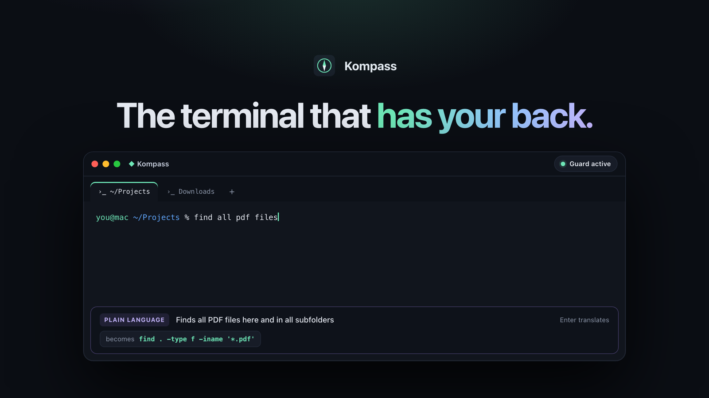
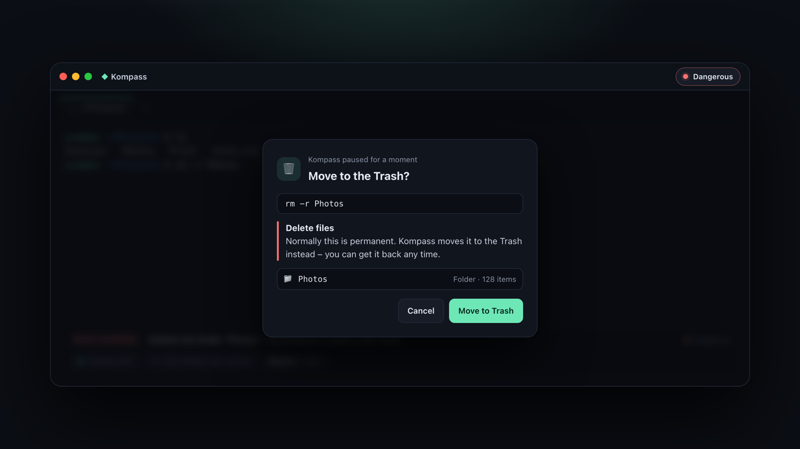
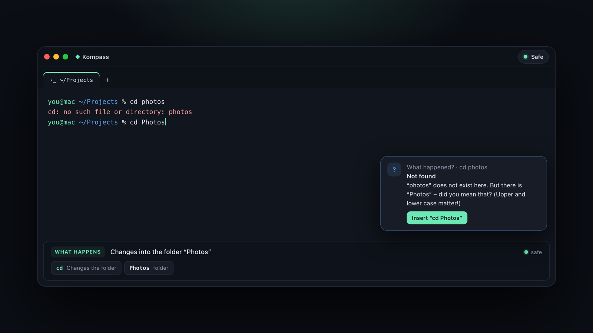
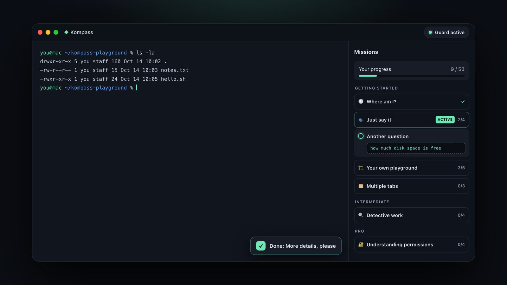

<p align="center">
  <a href="https://kompass-rust.vercel.app"></a>
</p>

<p align="center">
  <b>A free, friendly terminal for macOS.</b><br />
  It explains every command before it runs, stops the dangerous ones and understands plain English.<br />
  Made for people who are afraid of the terminal – and for pros who want to move faster.
</p>

<p align="center">
  <a href="https://github.com/klinkybill200/kompass/releases/latest/download/Kompass-macOS-arm64.dmg"></a>
</p>

<p align="center">
  <a href="https://github.com/klinkybill200/kompass/releases/latest"></a>
  <a href="https://github.com/klinkybill200/kompass/releases"></a>
  
  <a href="LICENSE"></a>
</p>

<p align="center">
  <a href="https://kompass-rust.vercel.app">Website</a> ·
  <a href="#-install">Install</a> ·
  <a href="#-build-from-source">Build</a> ·
  <a href="https://kompass-rust.vercel.app/#support">Support the project</a> ·
  <a href="#-auf-deutsch">Deutsch</a>
</p>

---

## ✨ What Kompass does

Kompass runs a **real zsh** with your own `.zshrc`, aliases and tools – and adds a friendly co-pilot on top.

### 🛡️ A guard that stops before it's too late

Every line is checked **before** it runs and rated *safe*, *careful* or *dangerous*. Risky commands – `rm`, `sudo`, `chmod`, `>` on an existing file, `curl … | sh` – get a dialog that says in plain words what will happen. And `rm` doesn't delete for good: files go to the **macOS Trash** and come back with one click on **Undo**.

<p align="center"></p>

### 💬 Plain language → command

Type what you want – *“find all pdf files”*, *“how much disk space is free”*, *“zeige alle dateien”*. Kompass puts the matching command into the line and **only runs it on your second Enter**, so you always see what happens (and learn the command along the way). Works offline in English and German; optionally falls back to Claude if you add your own API key.

### 🔎 Live explanations & 🩹 error help

While you type, a bar explains every part of the command. When something goes wrong, Kompass translates the error, spots typos and offers the fix with one click.

<p align="center"></p>

### 🧭 13 learning missions

From *“Where am I?”* to pipes, permissions and scripts – short missions in three levels that check the commands you actually ran. Pick any mission you like.

<p align="center"></p>

### And also

- 🗂️ **Tabs & native shortcuts** – ⌘T new tab in the same folder, ⌘W, ⌘1–9, ⌘K
- 🌍 **English & German** – UI, guard, explanations and plain language
- 🔒 **100 % local** – no account, no analytics, no tracking
- 💚 **Free** – no ads, no subscription

## 📦 Install

1. **[Download Kompass for macOS](https://github.com/klinkybill200/kompass/releases/latest/download/Kompass-macOS-arm64.dmg)** (macOS 11+, Apple Silicon).
2. Open the `.dmg` and drag **Kompass** into **Applications**.
3. Kompass is not notarized by Apple yet, so macOS warns on first launch: open **System Settings → Privacy & Security**, scroll down and click **“Open Anyway”**. You only need to do this once.

<details>
<summary>Prefer the terminal?</summary>

```bash
xattr -dr com.apple.quarantine /Applications/Kompass.app
```
</details>

All versions and checksums: [Releases](https://github.com/klinkybill200/kompass/releases).

## 🛠️ Build from source

You need [Rust](https://www.rust-lang.org/tools/install) (stable), Node.js 20+ and the Xcode command line tools.

```bash
git clone https://github.com/klinkybill200/kompass.git
cd kompass
npm install
npm run tauri dev      # run in development mode
npx tauri build        # build Kompass.app → src-tauri/target/release/bundle/macos/
```

Tests (Rust backend, incl. an end-to-end test with a real zsh):

```bash
cd src-tauri && cargo test
```

UI without the Rust backend: `npm run dev`, then open `http://localhost:1420/#danger` – `src/devmock.ts` simulates the backend (scenes: `#live #care #danger #trash #help #mission #nl #ki`).

<details>
<summary><b>How it works</b> (architecture)</summary>

Kompass starts zsh in a pseudo terminal (`portable-pty`) with a small shell integration (`src-tauri/shell/kompass.zsh`). The Enter key is redirected: before a line runs, zsh sends it invisibly to Kompass, waits for the answer and then runs, rewrites or cancels it.

| File | Purpose |
|---|---|
| `src-tauri/src/pty.rs` | one zsh per tab, bridge shell ↔ guard / plain language ↔ window |
| `src-tauri/src/guard.rs` | command guard: parses the line, rates it (safe / careful / dangerous) |
| `src-tauri/src/nl.rs` | plain language → command (local rules, recognizes real file names) |
| `src-tauri/src/ki.rs` | optional AI fallback via the Claude API (key stored in the macOS keychain) |
| `src-tauri/src/explain.rs` | live explanations: command lexicon (DE/EN), typo suggestions |
| `src-tauri/src/errors.rs` | error translator with suggested fixes |
| `src-tauri/src/trashlog.rs`, `trash_cli.rs` | Trash with undo log, `kompass-trash` / `kompass-undo` |
| `src-tauri/src/i18n.rs`, `src/i18n.tsx` | languages (backend messages and UI) |
| `src-tauri/src/lib.rs` | app start and native menu |
| `src/` | React UI: terminal (xterm.js), explanation bar, dialogs, missions, settings |
| `website/` | the website ([kompass-rust.vercel.app](https://kompass-rust.vercel.app), auto-deployed from `main`) |
| `docs/` | README images (`docs/make-shots.sh` renders them from `docs/shots.html`) |

Messages from the shell to Kompass are invisible OSC sequences (`US` = byte 0x1F):

| Sequence | Meaning |
|---|---|
| `ESC ]7770; base64(cmd);base64(cwd);known BEL` | check before running – reply `r.` run / `r<b64>.` run rewritten / `e<b64>.` insert command (plain language) / `n<b64>.` not understood / `c<b64>.` cancel |
| `ESC ]7771; cwd US known US line BEL` | live input while typing |
| `ESC ]7772; exit code US cwd BEL` | command finished |
| `ESC ]7773; batch BEL` | `kompass-trash` moved files to the Trash |

Code comments are written in German – Kompass started as a learning project for someone new to Rust.
</details>

## 🤝 Contributing

Ideas, bug reports and pull requests are very welcome. Phrases that Kompass doesn't understand yet make great issues! Please [open an issue](https://github.com/klinkybill200/kompass/issues/new/choose) first for bigger changes.

## 💚 Support

Kompass is freeware. If it helps you, a small [donation via PayPal](https://kompass-rust.vercel.app/#support) helps keep it maintained – or just leave a ⭐ on this repository.

## 🇩🇪 Auf Deutsch

**Kompass** ist ein kostenloses, freundliches Terminal für macOS. Es erklärt jeden Befehl, bevor er läuft, stoppt gefährliche Befehle mit einem verständlichen Dialog, legt mit `rm` gelöschte Dateien in den Papierkorb (inklusive Rückgängig) und versteht ganz normale Sätze wie *„finde alle pdf dateien“*. Dazu kommen 13 Lern-Missionen, Tabs und eine Fehlerhilfe. Die App ist komplett auf Deutsch und Englisch verfügbar.

**[Kompass für macOS herunterladen](https://github.com/klinkybill200/kompass/releases/latest/download/Kompass-macOS-arm64.dmg)** · [Webseite auf Deutsch](https://kompass-rust.vercel.app/?lang=de) · [Kontakt](https://kompass-rust.vercel.app/contact?lang=de)

## 📄 License

[MIT](LICENSE) © 2026 Andreas Klingenberger · [Legal notice / Impressum](https://kompass-rust.vercel.app/impressum)
